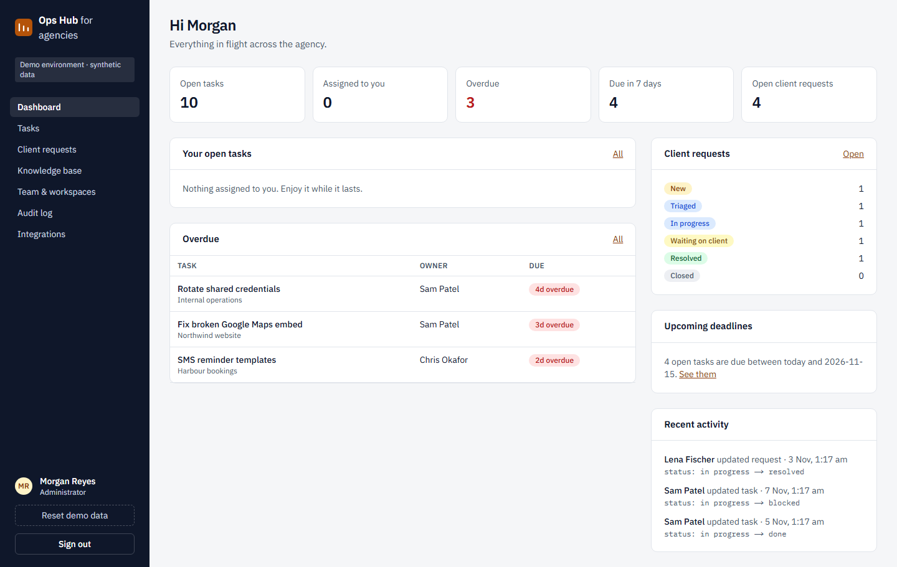

# Agency Operations Hub

The internal tool an agency team uses to run the week: **tasks**, **client requests**, a
**knowledge base**, an **immutable audit trail**, and **Slack notifications**, plus a typed REST API.

It's built to show backend engineering:
- relational modelling with workspace-scoped RLS
- trigger-enforced field rules and audit history
- optimistic concurrency and keyset pagination
- an outbox-based integration with leases, retries and rate-limit handling



> **Live demo:** https://agency-operations-hub-woad.vercel.app (one-click demo sign-in). All data is
> synthetic. Slack runs in a clearly labelled **mock mode** unless a webhook is configured.

## Try it

| Account | Email | Access |
|---|---|---|
| Morgan Reyes (admin) | `ops-admin@example.com` | everything |
| Sam Patel (staff) | `ops-sam@example.com` | Northwind website, Internal operations |
| Chris Okafor (staff) | `ops-chris@example.com` | Harbour bookings |

Password for all: `DemoOps!2026` (one-click buttons on the landing page).

1. **Sign in as Sam, then as Chris.** Each sees only their workspaces' tasks, requests and
   workspace-only articles.
2. **As Sam,** open *Image optimisation pass* and change its status. The form offers status and
   description only, and the change appears in History as `status: todo → in progress`.
3. **Concurrency:** open the same task as Morgan in two windows and save both. The second gets a
   conflict message instead of silently overwriting.
4. **As Morgan,** assign *Go-live checklist*, then open **Integrations**. The notification was
   queued in the same transaction and delivered (mock). Send a test with *Rate limited (429)* to
   see Retry-After scheduling.
5. **Audit log:** every change, column by column. Nobody can edit it.
6. **API:** see [docs/API.md](docs/API.md) for curl examples, including a 409 on a stale `version`.

## Features

- **Dashboard:** open, mine, overdue and due-this-week counts (one SQL function), overdue list,
  request pipeline, recent activity.
- **Tasks:** create (admin), assign, priorities, statuses, due dates, comments, per-task history,
  URL-driven filters (status, priority, assignee, workspace, due, search), keyset "Load more".
- **Client requests:** log from any channel, assign (admin), workflow from new through closed, a
  required resolution, internal notes.
- **Knowledge base:** categories, articles visible to everyone, admins only, or a single
  workspace; drafts.
- **Team & workspaces (admin):** roles, activation (immediate lock-out), workspace membership,
  clients.
- **Audit log (admin):** trigger-written diffs, filter by record type, keyset paging.
- **Slack integration (admin):** delivery log, retry, process queue, test messages, mock-mode
  failure simulation.
- **REST API:** `/api/v1/tasks` (list, create, get, patch) and `/api/v1/requests`.

Screenshots: [tasks](docs/screenshots/03-tasks.png) · [task detail](docs/screenshots/04-task-detail.png) ·
[integrations](docs/screenshots/05-integrations.png) · [audit](docs/screenshots/06-audit.png) ·
[team](docs/screenshots/07-team.png) · [mobile](docs/screenshots/08-mobile-dashboard.png)

## Tech stack

Next.js 16 (App Router, Server Actions, `after()`, route handlers) · React 19 · TypeScript (strict
+ `noUncheckedIndexedAccess`) · Tailwind CSS 4 · Supabase Auth + Postgres (RLS, triggers, PL/pgSQL)
· Zod 4 · pgTAP · Vitest · Playwright + axe · GitHub Actions · Vercel.

## Getting started

```bash
npm install
npx supabase start          # local stack on ports 554xx (runs alongside client-portal-mini)
cp .env.example .env.local  # paste PUBLISHABLE_KEY from `npx supabase status`
npm run dev                 # http://localhost:3001
```

| Variable | Notes |
|---|---|
| `NEXT_PUBLIC_SUPABASE_URL`, `NEXT_PUBLIC_SUPABASE_PUBLISHABLE_KEY` | public |
| `NEXT_PUBLIC_SITE_URL`, `NEXT_PUBLIC_DEMO_MODE` | public |
| `SLACK_WEBHOOK_URL` | **server-only**. Empty means mock mode. |

Database: migrations in `supabase/migrations/`, `npm run db:reset`, `npm run db:types`.

## Testing

| Command | Covers | Last local run (2026-11-08) |
|---|---|---|
| `npm run test:db` | pgTAP: workspace RLS, staff field guard, audit immutability and diffs, outbox leases and Retry-After, KB visibility, deactivation, grants, reset scope, trigger regression | 59 passed |
| `npm run test:unit` | Slack client against mocked `fetch` (200, 429, 5xx, 4xx, timeout, network, SSRF), dispatcher (stop and release on 429, spacing), cursors, schemas, dates, audit formatting | 46 passed |
| `npm run test:integration` | RLS and staff limits over PostgREST with real JWTs; regression for the trigger bug | 6 passed |
| `npm run test:e2e` | Production build: REST contract (401, 404, 409, 403, 422, CSRF, pagination), concurrent edits, Slack mock deliveries and 429, request workflow, KB restrictions, admin 404s, deactivation, axe, mobile | 19 passed |

CI (`.github/workflows/ci.yml`) runs all of these on every push and PR. CI passes on GitHub Actions.

## Debugging case study

[docs/case-studies/01-enum-cast-in-shared-trigger.md](docs/case-studies/01-enum-cast-in-shared-trigger.md):
a real bug where a shared trigger function broke task editing with `22P02`. It covers the root
cause, the failing test written first, the fix as a new migration, and the
[pull request description](docs/pull-requests/0001-fix-notification-trigger-enum-cast.md). The fix
was developed on `fix/notification-trigger-enum-cast` and merged with `--no-ff`.

## Docs

[Architecture](docs/ARCHITECTURE.md) · [Security](docs/SECURITY.md) · [API](docs/API.md) ·
[Deployment](docs/DEPLOYMENT.md) · [ADR 0001](docs/adr/0001-no-server-cache.md)

## Troubleshooting

| Symptom | Fix |
|---|---|
| Pages are empty after login | Expose the `ops` schema (`[api] schemas` locally; *Data API → Exposed schemas* hosted). |
| "/no-access" after signing in | The account isn't an active member. Reactivate it on Team, or run `npm run db:reset`. |
| Notifications stay "pending" | Click **Process due notifications**. Rate-limited items wait until their `next_attempt_at`. |
| `DELETE requires a WHERE clause` | Mass statements reachable through the API need a `WHERE` (pg-safeupdate). See client-portal-mini case study 1. |
| Port clash with the other app | This stack uses 55421–55429; the portal uses 54321–54329. |

## Future work

- A scheduled delivery worker with its own least-privilege credential.
- Slack interactive messages.
- Saved task views.
- Markdown rendering for KB articles.
- Workload charts once there's real history to chart.
- Member invitations (the same token pattern client-portal-mini already uses).
